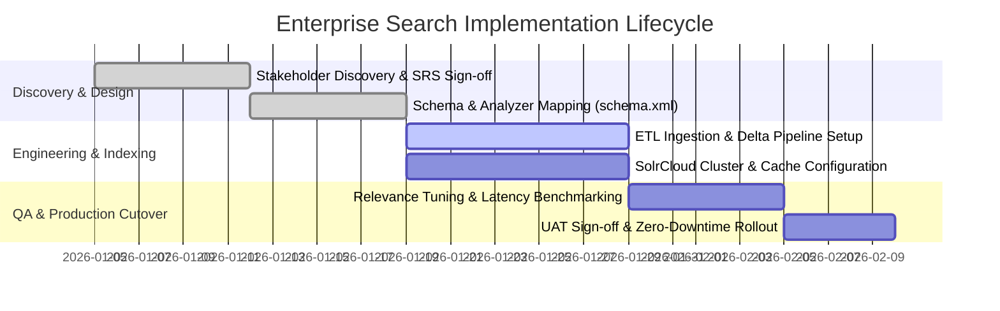

# 03. UAT & Performance Verification Plan

## 1. End-to-End Implementation & UAT Roadmap

## 2. Pre-Launch UAT Test Matrix
Every search release undergoes structured User Acceptance Testing (UAT) across relevance accuracy, edge-case queries, and latency thresholds before production sign-off.

| Test ID | Scenario | Input / Query Pattern | Expected System Behavior | Pass Criteria |
| :--- | :--- | :--- | :--- | :--- |
| **UAT-01** | Exact & Boosted Title Match | `q=wireless noise cancelling headphones` | Exact title matches rank in top 3 positions ahead of partial description matches | Top 3 relevance verified by Product Owner |
| **UAT-02** | Typo / Fuzzy Tolerance | `q=wireles headfones` | Fuzzy/synonym analyzer resolves misspelling without returning zero results | > 0 relevant results returned in < 200ms |
| **UAT-03** | Cached Facet Filtering | `q=*:*&fq=in_stock:true&fq=category:audio` | Subsequent identical `fq` calls hit Solr `filterCache` | Cache hit ratio > 85%; P95 latency < 100ms |
| **UAT-04** | Delta Index Propagation | Update item stock status to `false` in DB | Soft-commit triggers index refresh; item excluded from `in_stock:true` queries | Reflected in live search within ≤ 60 seconds |
| **UAT-05** | Special Character Sanitization | `q=model-X/200 (pro)` | Query parser escapes reserved Lucene syntax characters cleanly | HTTP 200 response; zero syntax exceptions |

## 3. Root-Cause Bottleneck Escalation Protocol
When latency spikes or relevance regressions occur during staging or production:
1. **Query Inspection (`debugQuery=true`):** Review parsed query weights and shard timing breakdowns to isolate slow clauses.
2. **Cache Telemetry Audit:** Check `filterCache`, `queryResultCache`, and `documentCache` eviction rates to identify undersized cache allocations or uncached dynamic filter patterns.
3. **Ingestion Audit:** Verify batch commit intervals (`autoCommit` vs. `autoSoftCommit`) to ensure heavy bulk updates do not contend with peak read traffic.
