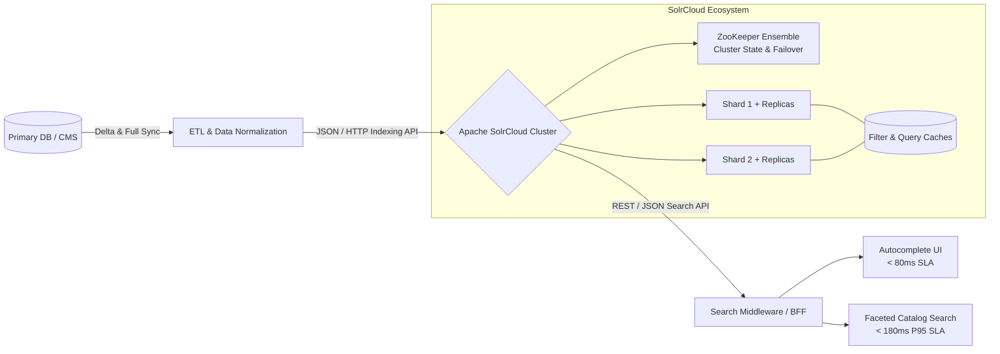

# Enterprise Search Implementation: SRS & Architecture Blueprint

## Overview
This repository contains a sanitized **Software Requirements Specification (SRS)**, **Search Schema Design**, and **UAT Performance Plan** created for a multi-catalog enterprise search and filtering implementation powered by **Apache Solr**.

As a **Technical IT Project Manager & Solutions Designer**, my role bridges business discovery and backend engineering—translating complex user search behaviors into structured data schemas, indexing workflows, query optimization rules, and measurable QA benchmarks.

## High-Level System Architecture

## Repository Structure
* **[01-system-architecture-srs.md](./01-system-architecture-srs.md)** — Functional & non-functional requirements, data ingestion flow, and high-level SolrCloud architecture.
* **[02-schema-indexing-design.md](./02-schema-indexing-design.md)** — Field-level schema definitions (`schema.xml` mapping), analyzer rules, and index vs. query-time optimization strategies.
* **[03-uat-performance-plan.md](./03-uat-performance-plan.md)** — Relevance tuning, latency SLAs, filter cache (`fq`) validation, and pre-launch UAT test cases.

## Core Focus Areas
* **System Design & Scoping:** End-to-end requirements gathering and architectural alignment between product stakeholders and backend engineers.
* **Search Optimization:** Structuring clean schemas, separating `indexed` vs. `stored` attributes, and leveraging filter queries to minimize P95 latency.
* **Delivery & Governance:** Milestone tracking, risk mitigation, and strict UAT sign-off protocols.
